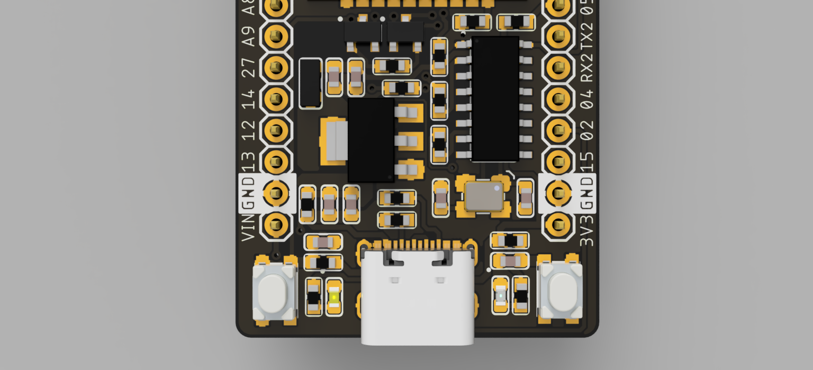

# ESP32 Development Board

A 2-layer ESP32 development board for testing ESP32-based applications, designed in EAGLE (2022). The design is finished.

## Files

- `EagleFiles/` – schematic (`.sch`) and board (`.brd`)
- `Schematic/` – schematic pages as images
- `Board/` – top and bottom layers
- `3D/` – 3D renders

License: CERN-OHL-S-2.0, see `license.txt`.
